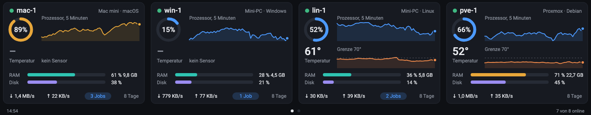

# Rackmon

[](https://github.com/toolwerk/rackmon/actions/workflows/ci.yml)
[](LICENSE)

[Deutsch](README.md) · **English**

**A small display in your rack shows how your machines are doing.** A tiny agent runs on each machine (Linux, macOS or Windows) and sends CPU load, memory, disk, network and temperature to a server every two seconds. The server shows the values live on a strip display, for example 1424 x 280 pixels in a 10-inch rack. More than four machines? The display pages through them.



The images show the author's real rack: a 10-inch rack with the [GeeekPi 6.91-inch display](https://deskpi.com/products/deskpi-6-91-inch-touch-screen-1424x280-tft-lcd-display-10-inch-1u-rackmount-monitor-for-deskpi-rackmate-t0-t1-t2-server-cabinets) (1424 x 280 pixels, 1U, touch screen, also sold as a DeskPi panel for the RackMate cabinets).

## Try it

No configuration, no agents, made-up values:

```bash
go run ./cmd/rackmon server -demo
```

Open `http://127.0.0.1:8470/screen/1`. Add `?page=2` to stay on page 2.

## Design

- **One program, two roles:** `rackmon agent` measures, `rackmon server` collects and displays. Go, a single file per operating system.
- **Agents push.** No open ports behind a firewall or with changing addresses. One token per machine.
- **Light:** a few MB of memory and almost no load, even on a Raspberry Pi.
- **Live, not an archive.** The server keeps only the last five minutes in memory.
- **Outages show at once:** after 6 seconds of silence the tile dims, after 30 seconds it turns red with the time of the last packet.

## Set up

```bash
rackmon token                                       # one token per machine
rackmon server -config server.yaml                  # see configs/server.example.yaml
rackmon agent -server http://server:8470 -token-file ./token
```

Service installers: `install/linux.sh`, `install/mac.sh`, `install/windows.ps1`. The agent runs without privileges. The token comes from a file, never from the command line.

## Just the numbers, as text

```bash
rackmon top                # live, like top, for all machines
rackmon top -once
rackmon server -config server.yaml -console 30s   # every 30 s into the log
```

## Security

One token per machine (24+ characters, compared in constant time), packets are validated, the server sets the time itself. The dashboard and `/api/state` are read-only without a login, so run the server in a private network and list only those addresses under `listen`.

## Development

```bash
make test    # go vet and tests with the race detector
make dist    # Linux (amd64, arm64, arm), macOS (arm64), Windows (amd64) in dist/
```

The design notes are in German: [docs/konzept.md](docs/konzept.md).

## License

[MIT](LICENSE)
