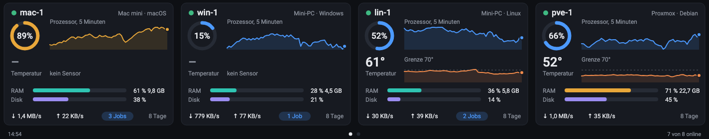
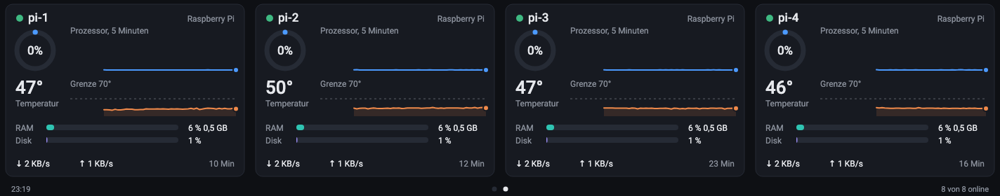

# Rackmon

[](https://github.com/toolwerk/rackmon/actions/workflows/ci.yml)
[](LICENSE)

**Deutsch** · [English](README.en.md)

**Ein kleines Display im Rack zeigt, wie es deinen Rechnern gerade geht.** Auf jedem Rechner läuft ein winziger Agent für Linux, macOS oder Windows. Er schickt alle zwei Sekunden Prozessorlast, Speicher, Datenträger, Netz und Temperatur an einen Server. Der Server zeigt die Werte live auf einem Streifen-Display an, zum Beispiel mit 1424 x 280 Bildpunkten im 10-Zoll-Rack. Mehr als vier Rechner? Dann blättert die Anzeige seitenweise.





Die Bilder zeigen das echte Rack des Autors: ein 10-Zoll-Rack mit dem [GeeekPi 6,91-Zoll-Display](https://deskpi.com/products/deskpi-6-91-inch-touch-screen-1424x280-tft-lcd-display-10-inch-1u-rackmount-monitor-for-deskpi-rackmate-t0-t1-t2-server-cabinets) (1424 x 280 Bildpunkte, 1U, Touchscreen, auch als DeskPi-Panel für die RackMate-Schränke erhältlich).

## Ausprobieren

Ohne Konfiguration und ohne Agenten, mit erfundenen Werten:

```bash
go run ./cmd/rackmon server -demo
```

Dann `http://127.0.0.1:8470/screen/1` im Browser öffnen. Mit `?page=2` bleibt die Anzeige auf Seite 2.

## Aufbau

- **Ein Programm, zwei Rollen:** `rackmon agent` misst, `rackmon server` sammelt und zeigt an. Go, eine einzige Datei pro Betriebssystem, kein Laufzeitpaket nötig.
- **Agenten senden selbst.** Hinter einer Firewall oder bei wechselnden Adressen muss kein Port geöffnet werden. Jeder Rechner hat ein eigenes Token.
- **Leicht:** wenige MB Arbeitsspeicher und kaum Last, auch auf einem Raspberry Pi.
- **Live statt Archiv.** Der Server hält nur die letzten fünf Minuten im Speicher.
- **Ausfälle sind sofort sichtbar:** Nach 6 Sekunden Stille wird die Kachel gedimmt, nach 30 Sekunden rot mit der Zeit des letzten Pakets.

## Server einrichten

1. Pro Rechner ein Token erzeugen: `rackmon token`
2. [configs/server.example.yaml](configs/server.example.yaml) kopieren, Rechner und Tokens eintragen.
3. Starten: `rackmon server -config server.yaml`
4. Als Dienst auf Linux: `sudo install/linux.sh server --binary ./rackmon --config ./server.yaml`

Der Server hört nur auf den Adressen, die in `listen` stehen (mehrere mit Komma). Trage dort das private Netz und `127.0.0.1` ein, nicht `0.0.0.0`.

## Agenten einrichten

| System | Aufruf |
|---|---|
| Linux, Raspberry Pi, Proxmox | `sudo install/linux.sh agent --binary ./rackmon --server http://server:8470 --token-file ./token` |
| macOS | `sudo install/mac.sh --binary ./rackmon --server http://server:8470 --token-file ./token` |
| Windows (Administrator-PowerShell) | `.\install\windows.ps1 -Binary .\rackmon.exe -Server http://server:8470 -TokenFile .\token` |

Das Token kommt aus einer Datei, nie von der Kommandozeile. Der Agent läuft ohne Rechte: als dynamischer Benutzer (Linux), als `nobody` (macOS) und als `LocalService` (Windows).

## Nur die Werte, als Text

Wer keine Grafik will:

```bash
rackmon top                # live, wie top, für alle Rechner
rackmon top -once          # einmal ausgeben
rackmon server -config server.yaml -console 30s   # alle 30 s ins Protokoll
```

```
HOST   STATE    CPU  LOAD  MEM  MEM-USED     DISK  TEMP  RX       TX      JOBS  POWER  UPTIME  SEEN
mac-1  ok       38%  -     61%  9.7G/16.0G   38%   -     360KB/s  86KB/s  3     -      8d0h    1s
lin-1  ok       68%  0.42  36%  5.8G/16.0G   14%   63C   1.2MB/s  5KB/s   2     -      8d0h    1s
pi-3   ok       53%  0.90  63%  2.5G/4.0G    52%   72C   584KB/s  80KB/s  0     WARN   7d0h    1s
pi-4   offline  -    -     -    -            -     -     -        -       -     -      -       -
```

`console_interval: 60s` in der Konfiguration schaltet die Ausgabe dauerhaft ein.

## Was gemessen wird

| Wert | Linux | macOS | Windows |
|---|---|---|---|
| Prozessor, RAM, Swap, Datenträger, Netz, Uptime | ja | ja | ja |
| Load-Average | ja | ja | nein |
| CPU-Temperatur | ja | ja, wo das System sie liefert | nur mit [LibreHardwareMonitor](https://github.com/LibreHardwareMonitor/LibreHardwareMonitor) (siehe unten) |
| Raspberry Pi: Unterspannung, Drosselung | ja | nein | nein |
| Laufende Jobs eines GitHub-Runners | ja | ja | ja |

Fehlt ein Wert, bleibt er leer und die Kachel zeigt einen Strich.

**Temperatur unter Windows:** Windows hat dafür keine eingebaute Schnittstelle. LibreHardwareMonitor liest die Sensoren und stellt sie mit seinem Web-Server als `data.json` bereit. Der Agent holt die Prozessortemperatur von dort, wenn er mit `-temp-url http://127.0.0.1:8085/data.json` (oder `RACKMON_TEMP_URL`) startet. Erlaubt sind nur Adressen auf dem eigenen Rechner. Der Web-Server von LibreHardwareMonitor sollte nur auf `127.0.0.1` lauschen. Beim Installieren des Dienstes: `install/windows.ps1 ... -TempUrl http://127.0.0.1:8085/data.json`.

## Anzeige an einem Rechner betreiben

Das Dashboard ist eine Webseite für den Kiosk-Modus eines Browsers. Wie Haupt- und Monitoring-Bildschirm an einem Rechner zusammenspielen, steht in [docs/anzeige.md](docs/anzeige.md). Das Konzept dahinter: [docs/konzept.md](docs/konzept.md), der Stand der Umsetzung: [docs/plan.md](docs/plan.md).

## Sicherheit

- Ein Token je Rechner, mindestens 24 Zeichen, der Server vergleicht zeitkonstant und speichert nur, was der Rechner senden darf.
- Pakete werden geprüft (Wertebereiche, Größe) und der Server setzt die Zeit selbst.
- Das Dashboard und `/api/state` sind nur lesend und ohne Anmeldung. Daher gehört der Server in ein privates Netz.
- Das Token steht nie in Ausgaben des Servers.

## Entwicklung

```bash
make test    # go vet und Tests mit Race-Prüfung
make dist    # Programme für Linux (amd64, arm64, arm), macOS (arm64) und Windows (amd64) in dist/
```

## Lizenz

[MIT](LICENSE)
